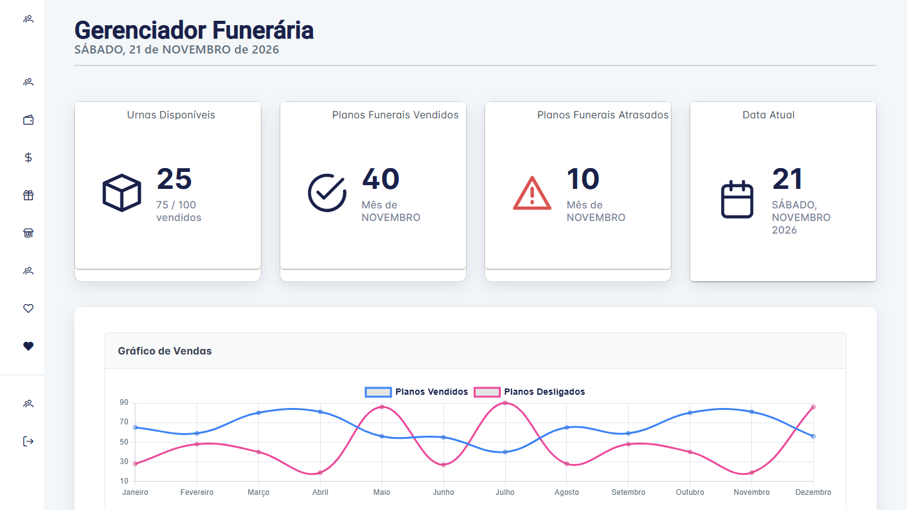
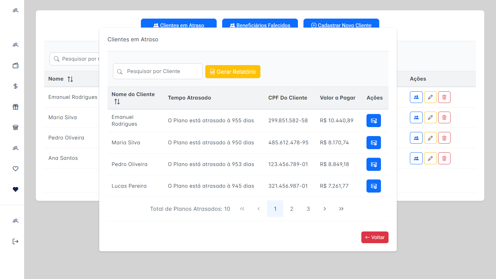
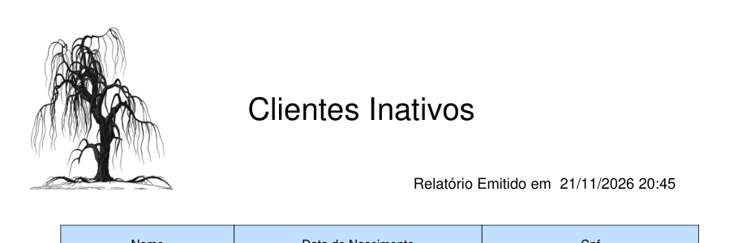
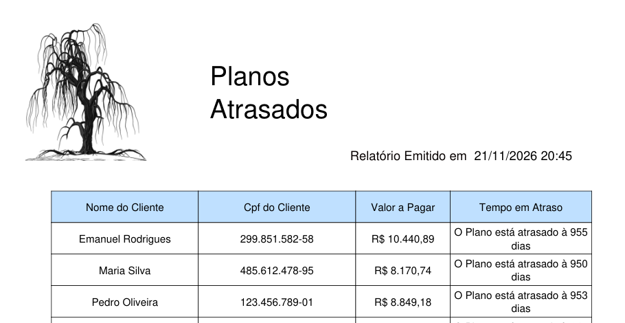
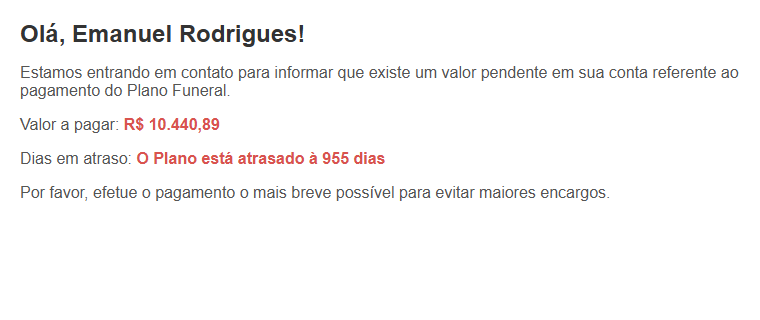
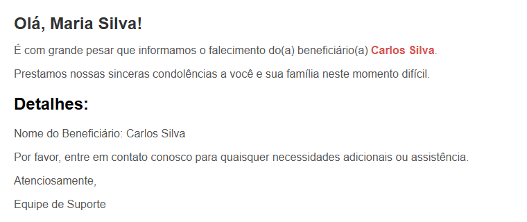

# 🕊️ Genro Feliz — API de Gestão para Funerária (Back-end)

API REST do sistema **Genro Feliz**, que gerencia clientes, beneficiários, planos funerários, caixões, salas de velório, falecimentos, vendedores e planos de saúde de uma funerária. Também gera **relatórios em PDF** (JasperReports) e envia **e-mails HTML** (Thymeleaf + JavaMail).

O front-end (Angular 17) fica em:
👉 **[Projeto-Funeraria-Front](https://github.com/GabriellSouzaa/Projeto-Funeraria-Front)**, com prints de todas as telas



---

## 📑 Sumário

- [Tecnologias](#-tecnologias)
- [Arquitetura](#-arquitetura)
- [Modelo de dados](#-modelo-de-dados)
- [Endpoints](#-endpoints)
- [Destaques: funções interessantes](#-destaques-funções-interessantes)
- [Relatórios em PDF (JasperReports)](#-relatórios-em-pdf-jasperreports)
- [E-mails transacionais](#-e-mails-transacionais)
- [Como executar](#-como-executar)

---

## 🧰 Tecnologias

| Categoria | Tecnologias |
|---|---|
| Linguagem / Build | **Java 22** (toolchain do Gradle), **Gradle 8.8** |
| Framework | **Spring Boot 3.3**: Web, Data JPA, Validation, Security, Mail, DevTools |
| Banco de dados | **PostgreSQL**, Hibernate (`ddl-auto: update`), scripts Flyway em `db/migration` |
| Segurança | Spring Security stateless + **JWT** (`com.auth0:java-jwt`), senhas com **BCrypt** |
| Relatórios | **JasperReports 6.21** (templates `.jrxml` compilados em tempo de execução) |
| E-mail | **Thymeleaf** (templates HTML) + **JavaMailSender** (SMTP) |
| Outros | Lombok, integração com a API Google Gemini (`/chat`) |

---

## 🏛️ Arquitetura

O projeto segue uma organização inspirada em **Clean Architecture**, com as regras de negócio isoladas atrás de interfaces (*gateways*):

```
src/main/java/funerary/genro/feliz/
├── domain/                  # Entidades JPA (Client, FuneralPlan, Coffin, ...) e enums
├── app/
│   ├── usecases/            # Interfaces "Gateway" (contratos dos casos de uso)
│   │   └── impl/            # Regras de negócio: juros, descontos, relatórios, e-mail
│   ├── repositories/        # Interfaces de repositório do domínio
│   ├── models/requests|responses/   # DTOs (records) de entrada e saída
│   └── exception/           # Exceções customizadas + @ControllerAdvice
├── infra/
│   ├── controllers/         # Endpoints REST
│   ├── database/            # Spring Data JPA (*Data) + adaptadores (*RepositoryImpl)
│   ├── cors/  config/
└── auth/                    # SecurityFilterChain, filtro JWT, TokenService, UserDetailsService
```

```
Controller ──► Gateway (interface) ──► Impl (regra de negócio) ──► Repository (interface) ──► RepositoryImpl ──► Spring Data JPA
```

---

## 🗃️ Modelo de dados

| Tabela | Descrição |
|---|---|
| `cliente` | Titulares: dados pessoais, CPF/RG, contato, status ativo/inativo |
| `beneficiary` | Dependentes de um cliente, com valor adicional e status |
| `funeral_plan` | Plano funerário do cliente: valor, vencimento, pagamento do mês |
| `coffin` | Urnas: material, cor, comprimento, modelo, preço |
| `coffin_salles` | Vendas de urna (vendedor × urna × cliente × data) |
| `seller` / `seller_salles` | Vendedores e suas vendas |
| `funeral_parlor` / `funeral_parlor_usages` | Salas de velório e o histórico de uso |
| `patient_death` | Óbitos: sala, urna, conservação química, causa |
| `health_plan` | Planos de saúde parceiros |
| `users` | Usuários do sistema (login, senha BCrypt, role) |

Dados de exemplo para popular o banco: [`src/main/resources/data.sql`](genro.feliz/src/main/resources/data.sql).

---

## 🔌 Endpoints

Todas as rotas, exceto `/auth/login` e `/auth/register`, exigem o header `Authorization: Bearer <token>`.
As rotas 🔒 exigem a role **ADMIN**.

| Recurso | Endpoints |
|---|---|
| **Auth** `/auth` | `POST /login` · `POST /register` · `GET /user-info` |
| **Clientes** `/client` | `GET /` 🔒 · `GET /{id}` 🔒 · `POST /create` · `PUT /update/{id}` · `DELETE /delete/{id}` · `GET /discount/{id}` · `GET /report` (PDF clientes inativos) |
| **Beneficiários** `/beneficiary` | `GET /` · `GET /{id}` · `POST /create` · `PUT /update/{id}` · `DELETE /delete/{id}` · `GET /client/{id}` · `GET /death/client/{id}` (inativos) · `GET /client/report/{id}` (PDF) |
| **Planos funerários** `/funeral-plan` | `GET /` 🔒 · `GET /atrasados` 🔒 · `POST /create` · `POST /update/{id}` · `DELETE /delete/{id}` · `GET /report/delayed-plan` (PDF) |
| **Caixões** `/coffin` | `GET /` · `GET /{id}` · `POST /create` · `PUT /update/{id}` · `DELETE /delete/{id}` |
| **Vendas de caixão** `/coffin-sales` | CRUD completo + `GET /report` (PDF mensal) |
| **Salas de velório** `/funeral-parlor` | CRUD completo |
| **Uso das salas** `/funeral-parlor-usages` | `GET /report` (PDF mensal) |
| **Falecimentos** `/patient-death` | CRUD completo |
| **Vendedores** `/seller` | CRUD completo |
| **Vendas por vendedor** `/seller-salles` | `GET /report` (PDF mensal) |
| **Planos de saúde** `/health-plan` | CRUD completo |
| **E-mail** `/email` | `GET /{nomeCliente}/{idPlano}` (cobrança) · `GET /beneficiary/{id}` (condolências) |
| **IA** `/chat` | `GET /generate/{prompt}` (proxy para o Google Gemini) |

### Exemplo de uso

```bash
# 1. Autenticar
TOKEN=$(curl -s -X POST localhost:8080/auth/login \
  -H "Content-Type: application/json" \
  -d '{"login":"admin","password":"admin123"}' | jq -r .token)

# 2. Listar planos em atraso com juros calculados
curl -s localhost:8080/funeral-plan/atrasados -H "Authorization: Bearer $TOKEN"
```

```json
[
  {
    "id": 1,
    "tempoAtrasado": "O Plano está atrasado à 955 dias",
    "nomeCliente": "Emanuel Rodrigues",
    "cpfCliente": "299.851.582-58",
    "valorAPagar": "R$ 10.440,89"
  }
]
```

---

## 🌟 Destaques: funções interessantes

### 1. Juros compostos para planos em atraso — `CalculateDelayedPlan`

Para cada plano vencido, a API calcula os dias de atraso e aplica **5% de juros compostos por mês**, devolvendo o valor já formatado em reais (`pt-BR`):

```java
if (hoje.isAfter(funeralPlan.getDataPagamento())) {
    long mesesAtraso = ChronoUnit.MONTHS.between(
            funeralPlan.getDataPagamento().withDayOfMonth(1),
            hoje.withDayOfMonth(1));
    valor = (float) (valor * Math.pow(1 + 0.05, mesesAtraso));
}
return NumberFormat.getCurrencyInstance(new Locale("pt", "BR")).format(valor);
```

O mesmo cálculo alimenta a listagem, o relatório PDF e o e-mail de cobrança.



### 2. Relatórios PDF dinâmicos

`ReportUtilsImpl` carrega o `.jrxml`, compila com `JasperCompileManager`, preenche passando como parâmetro um `JRBeanCollectionDataSource` montado a partir dos DTOs e devolve o PDF como `ResponseEntity<byte[]>` com `Content-Disposition: attachment`.

### 3. E-mails HTML com Thymeleaf

`EmailImpl` renderiza templates HTML com variáveis do domínio (nome, valor corrigido, dias de atraso, beneficiário) e envia pelo `JavaMailSender`.

### 4. Autenticação stateless com JWT

- `SecurityFilter` lê o `Bearer` token, valida com `TokenService` (issuer `auth-api`, expiração de 2h) e popula o `SecurityContext`.
- O enum `UserRole` mapeia `ADMIN` para as authorities `ROLE_ADMIN` e `ROLE_USER`.
- As senhas são armazenadas com BCrypt.

### 5. Tratamento de erros padronizado

`ExceptionHandle` (`@ControllerAdvice`) converte exceções de negócio (`ClientNotFoundException`, `ClientBadRequestException`) e erros de validação em respostas JSON padronizadas (`PadraoErro`, `ValidationError` com a lista de `FieldMessage`).

---

## 📄 Relatórios em PDF (JasperReports)

Templates em [`src/main/resources/relatorios`](genro.feliz/src/main/resources/relatorios). Os PDFs abaixo foram gerados pela API com os dados de exemplo:

| Beneficiários de um cliente | Clientes inativos |
|---|---|
|  |  |

**Planos funerários atrasados** (com o valor já corrigido pelos juros):



Os outros relatórios disponíveis são vendas mensais de caixão, vendas mensais por vendedor e salas de velório usadas no mês. Eles filtram pelo **mês corrente**, então só mostram dados quando há registros no mês atual.

---

## ✉️ E-mails transacionais

Templates Thymeleaf em [`src/main/resources/templates`](genro.feliz/src/main/resources/templates). Prévia renderizada com dados de exemplo:

| Cobrança de plano atrasado | Beneficiário falecido |
|---|---|
|  |  |

---

## 🚀 Como executar

### Pré-requisitos

- **JDK 22**, exigido pelo toolchain em `build.gradle`. Com outro JDK (ex.: 21), ajuste `languageVersion` no `build.gradle`.
- **PostgreSQL** (local ou via Docker)

### 1. Banco de dados

```bash
docker run -d --name genrofeliz-db \
  -e POSTGRES_PASSWORD=1234 -e POSTGRES_DB=genroFeliz \
  -p 5432:5432 postgres:16-alpine
```

A conexão é configurada em `genro.feliz/src/main/resources/application.yaml` (`localhost:5432/genroFeliz`, usuário `postgres`).

### 2. Variáveis de ambiente

| Variável | Uso |
|---|---|
| `JWT_SECRET` | Segredo de assinatura do JWT (padrão: `my-secret-key`) |

Para o envio de e-mails, configure `spring.mail.username` e `spring.mail.password` com uma conta SMTP sua (ex.: senha de app do Gmail).

### 3. Subir a API

```bash
cd genro.feliz
./gradlew bootRun          # Windows: gradlew.bat bootRun
```

A API sobe em **http://localhost:8080**. Na primeira execução, o Hibernate cria as tabelas automaticamente.

### 4. Popular com dados de exemplo (opcional)

Com a API já iniciada pelo menos uma vez (para as tabelas existirem):

```bash
docker exec -i genrofeliz-db psql -U postgres -d genroFeliz < genro.feliz/src/main/resources/data.sql
```

### 5. Criar um usuário administrador

```bash
curl -X POST http://localhost:8080/auth/register \
  -H "Content-Type: application/json" \
  -d '{"login":"admin","password":"admin123","role":"ADMIN",
       "firstName":"Admin","lastName":"Demo","cpf":"00000000000","dataNascimento":"1990-01-01"}'
```

Depois, suba o [front-end](https://github.com/GabriellSouzaa/Projeto-Funeraria-Front) e acesse `http://localhost:4200`.

---

Projeto acadêmico desenvolvido com Spring Boot e Angular.
